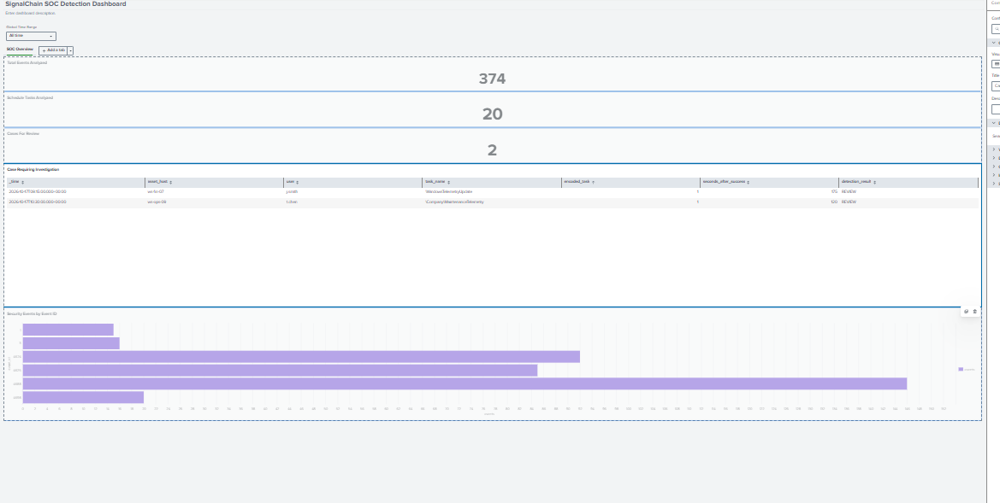
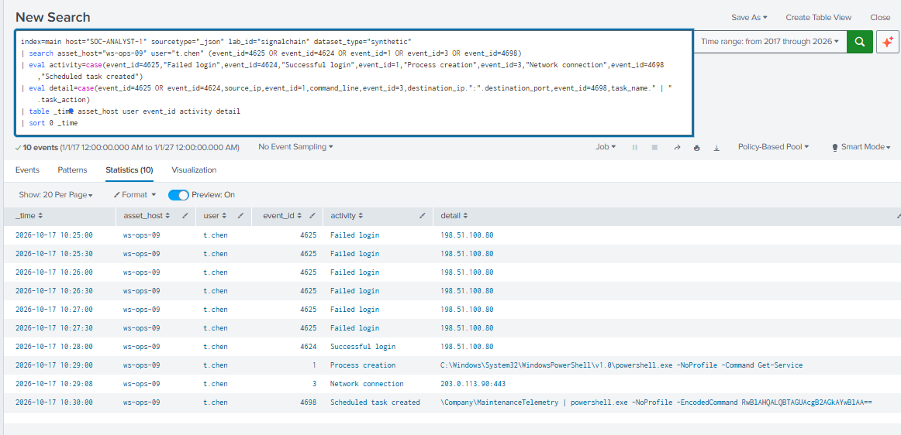
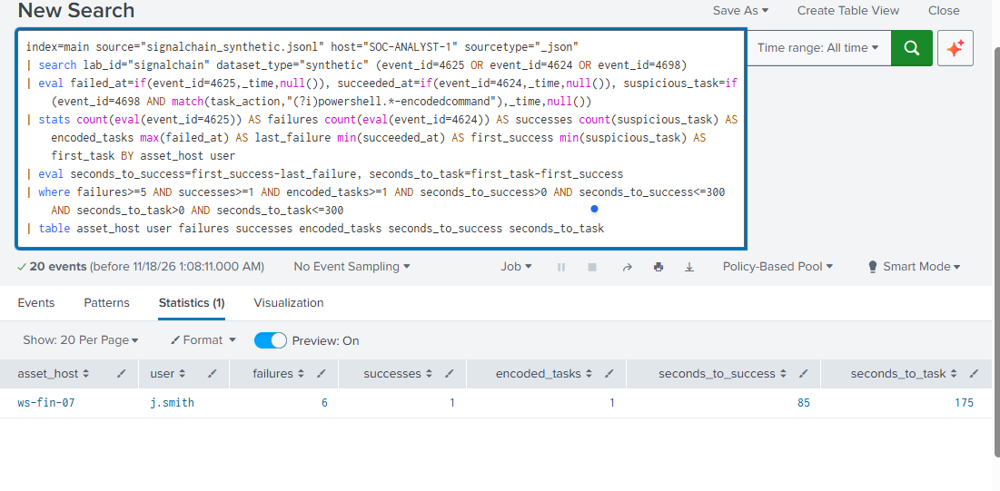

# SignalChain SOC Lab

I used Python and Splunk to investigate synthetic Windows authentication activity, PowerShell execution, Sysmon network events, and scheduled task creation. This project documents how I reviewed the evidence, built event timelines, and decided when activity needed a second analyst's review.

The lab runs on an 8 GB Windows laptop without virtual machines. Python handles the sample data and validation steps. Splunk is used separately for searching and visualizing the events.

## Project results

I started with 44 synthetic Windows and Sysmon events. I then used a Python script to generate another 330 events, including normal activity and scenarios designed to challenge the detection logic.

The combined Splunk investigation contains 374 events and 20 scheduled tasks. Two task-related sequences were marked for review; the other 18 were not flagged by the correlation search shown in the lab screenshots.



The event counts come from two separate files: the original 44-event sample and the 330-event generated background file. They are not interchangeable stages of the same dataset.

## Case investigations

### Case 001: j.smith

Six failed login attempts were followed by a successful login on `ws-fin-07`. PowerShell activity and the creation of an encoded scheduled task appeared shortly afterward.

My decision was to keep the event under review and recommend additional endpoint and authorization checks. The logs alone do not prove account compromise.

[Read Case 001](cases/CASE-001.md)


### Case 002: t.chen

I found six failed logons followed by a successful logon on `ws-ops-09`. The timeline also showed a PowerShell `Get-Service` process, a network connection with the same Sysmon `ProcessGuid`, and a new scheduled task containing `-EncodedCommand`.

I recommended Tier 2 review. The process and network records appeared before the task was created, so they cannot prove that the task executed. The data also cannot establish that these events originated from the successful logon session.

[Read Case 002](cases/CASE-002.md)



## Tools used

- Python 3 for JSONL processing, synthetic event generation, basic correlation checks, and regression tests.
- Splunk for SPL searches, event timelines, dashboard views, and alert review.
- Windows Security events 4624, 4625, and 4698.
- Sysmon events 1 and 3 for process and network context.
- PowerShell for running the local scripts on Windows.

## Running the Python portion

Open PowerShell in this repository's folder. Python 3 is required; no third-party Python packages are needed for the included scripts.

First, validate the original sample and run the included tests:

```powershell
py -3 tools/validate_lab.py
py -3 -m unittest discover -s tests -v
```

The sample has 44 records and one login-to-task review candidate. The tests included with this uploaded version currently contain eight checks.

To reproduce the expanded dataset and counts:

```powershell
py -3 tools/generate_background.py
py -3 tools/validate_lab.py --expanded
```

The generator creates 330 additional synthetic records inside `.local/splunk/`. The validator should report 374 combined events, 20 scheduled tasks, and two review candidates. The generator intentionally refuses to overwrite an existing output file.

To export the original 44 records in Splunk-ready JSONL format:

```powershell
py -3 tools/export_to_splunk.py
```

This produces `.local/splunk/signalchain_synthetic.jsonl`. The export script only writes a local file; it does not connect to Splunk.

## Splunk investigation

1. Open Splunk and go to Settings, Add Data, then Upload.
2. Upload `.local/splunk/signalchain_synthetic.jsonl` as JSON event data.
3. Upload `.local/splunk/signalchain_background.jsonl` as a separate JSON event source.
4. Set up timestamp extraction and the correct target index for your installation.
5. Search for `lab_id=signalchain dataset_type=synthetic` and confirm that the two files produce 374 events without duplicate uploads.
6. Use the searches in [`splunk/searches.spl`](splunk/searches.spl) to inspect scheduled tasks and investigate each account.



The two cases are examples of a suspicious sequence requiring context, not confirmed incidents. A failed-login pattern, an encoded command, or a process GUID match is not sufficient on its own to identify malicious behavior.

## Project files

- `data/` contains the original synthetic sample and a benign-control dataset.
- `tools/` contains the supplied synthetic-data generator, public-data adapter, Windows log exporter, and the Python validation and Splunk export helpers.
- `tests/` contains checks for dataset counts, correlation edge cases, and the Splunk export format.
- `splunk/searches.spl` contains the searches used to explore the dataset and cases.
- `cases/` contains the two investigation reports.
- `screenshots/` contains the dashboard, queries, test history, and event evidence.
- `docs/` contains the publishing instructions and notes about what can be reproduced.

## Limitations

This is a controlled lab with simulated security records. It does not execute attack commands, verify actual account access, or confirm that either scheduled task ran. The example IP addresses are part of the synthetic dataset, not live threat intelligence.

The original offline dashboard program and its earlier 33-test suite were not among the files available for this GitHub package. Some screenshots show that earlier stage. For the downloadable version here, I used the supplied data and helper scripts with a small, rebuilt validation script and eight current tests. This makes the available data and the two case timelines reproducible without suggesting that the old dashboard source is included.

I have kept generated files in `.local/` outside Git. Windows event exports from a real machine may contain sensitive information and should not be committed to this repository.
