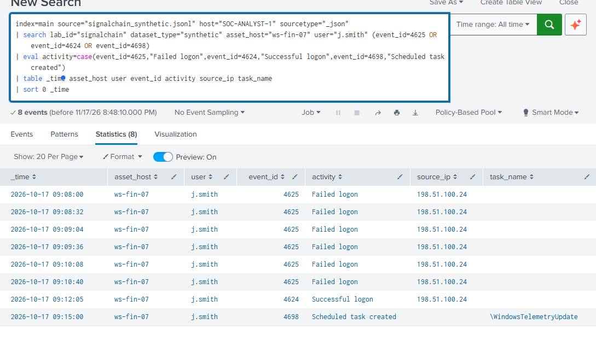

# SignalChain SOC Lab

SignalChain is a cybersecurity project focused on investigating suspicious Windows activity with Python and Splunk. I worked with simulated security logs to review authentication failures, PowerShell processes, network connections, and scheduled tasks. I documented two cases and the evidence behind each escalation decision.

The Python portion runs on an 8 GB Windows laptop without a virtual machine. Splunk was used separately to search, correlate, and visualize the events.

## Project overview

I began with a sample of 44 synthetic Windows Security and Sysmon events. I then used a Python generator to add 330 more events representing routine activity and several scenarios that test the detection conditions.

The expanded investigation contains 374 events and 20 scheduled tasks. Two sequences warranted further review; the remaining 18 tasks were not flagged by the lab's correlation search.

## Case investigations

### Case 001 — Suspicious login and scheduled task

I investigated six failed login attempts involving the j.smith account on ws-fin-07. A successful login was followed by PowerShell activity and the creation of a scheduled task with an encoded command.

I recommended escalation to a Tier 2 SOC analyst to check whether the activity was authorized. The available logs did not prove that the account was compromised.

[Read the Case 001 investigation](cases/CASE-001.md)

### Case 002 — Login activity, PowerShell, and network connection

The second investigation involved t.chen on ws-ops-09. Six failed logins were followed by a successful login, PowerShell execution, a network connection, and an encoded scheduled task.

The PowerShell process and network connection shared a Sysmon process identifier. Both records appeared before the scheduled task was created, so they do not demonstrate that the task actually ran. I retained the review status and recommended additional investigation.

[Read the Case 002 investigation](cases/CASE-002.md)

## Tools and techniques

- Python for processing JSONL data, generating additional synthetic events, and validating correlation conditions.
- Splunk for searching Windows and Sysmon events, building timelines, and reviewing scheduled tasks.
- Windows Security event IDs 4624, 4625, and 4698.
- Sysmon event IDs 1 and 3 for process and network context.
- PowerShell for running the local Python scripts.

## Reproducing the Python analysis

The project uses Python 3 and its standard library. Open PowerShell in the downloaded project folder to run the commands below.

1. Run py -3 tools/validate_lab.py to check the 44-event baseline.
2. Run py -3 -m unittest discover -s tests -v to execute the eight included tests.
3. Run py -3 tools/generate_background.py to create 330 additional synthetic events.
4. Run py -3 tools/validate_lab.py --expanded to check the combined dataset.

The expanded validation should report 374 events, 20 scheduled tasks, and two review candidates. The generator saves its output inside the local folder and will not overwrite an existing generated file.

To prepare the original 44-event sample for Splunk, run py -3 tools/export_to_splunk.py. The exported file is saved locally and must be uploaded to Splunk manually.

## Splunk investigation

The Splunk portion uses two synthetic JSONL files: the original 44-event export and the additional 330-event background sample.

1. In Splunk, open Settings, Add Data, and Upload.
2. Upload the baseline file from .local/splunk/signalchain_synthetic.jsonl.
3. Upload the background file from .local/splunk/signalchain_background.jsonl.
4. Confirm that the combined search returns 374 events without duplicate uploads.
5. Use the searches in the [Splunk search file](splunk/searches.spl) to examine the two cases and related scheduled tasks.

## Project files

The data folder contains the synthetic baseline and benign-control samples. The tools folder contains the Python helpers and an optional Windows event-export script. The tests folder contains checks for the included scripts and correlation logic.

The Splunk folder contains investigation searches. The cases folder contains the two analyst reports, and the screenshots folder contains the supporting evidence. Additional details are in the [reproducibility notes](docs/REPRODUCIBILITY.md).

## Limitations

All security events in this project are synthetic. A sequence of failed logins, PowerShell activity, and scheduled task creation can justify investigation, but it does not establish a real intrusion. Event timing alone also cannot prove that activity originated from a particular login session.

The original offline dashboard program and its earlier 33-test suite are not included in this published version. The current repository contains the source files provided for the project, a rebuilt validation helper, and eight tests that can be rerun.

Generated files are kept outside the published repository. Real Windows event logs may contain sensitive information and should not be uploaded without authorization and review.
